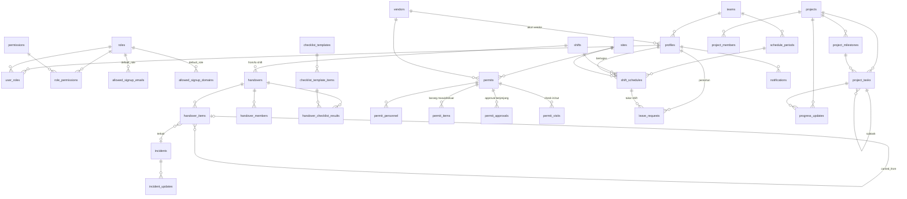

# NOC Platform — Skema & Arsitektur

## 1. Arsitektur

Monorepo (Turborepo + pnpm). Satu database Supabase dipakai bersama oleh semua app.

```
noc/
├── apps/
│   ├── portal/          # Login, launcher app, dashboard, master data, user & role, notifikasi
│   ├── jadwal/          # Roster shift: kalender, publish, tukar shift
│   ├── handover/        # Serah terima shift + checklist
│   ├── perizinan/       # Izin kerja/akses site + izin personel (cuti/tukar shift)
│   └── perkembangan/    # Project, task, laporan progress
├── packages/
│   ├── db/              # Supabase client, generated types, query helpers
│   ├── ui/              # Komponen UI bersama (shadcn/ui + Tailwind)
│   ├── auth/            # Session, middleware, hook usePermission()
│   └── config/          # tsconfig, eslint, tailwind preset
├── supabase/
│   ├── migrations/      # SQL migration (sumber kebenaran skema)
│   └── seed.sql
└── docs/
```

| Layer     | Pilihan                                                     |
|-----------|-------------------------------------------------------------|
| Frontend  | Next.js (App Router) + TypeScript + Tailwind + shadcn/ui    |
| Hosting   | Vercel (atau Cloudflare via `@opennextjs/cloudflare`)       |
| Backend   | Supabase: Postgres + Auth + Storage + Realtime              |
| Domain    | `noc.domain.com` (portal), `jadwal.noc.domain.com`, dst     |

Agar login berlaku di semua app, cookie session Supabase diset ke parent domain (`.noc.domain.com`).

## 2. Pembatasan Pendaftaran Akun

Hanya email berikut yang bisa membuat akun (berlaku untuk email/password, magic link, dan login Google):

| Aturan | Nilai | Role awal |
|---|---|---|
| Email spesifik | `dzakwan.corp@gmail.com` | `admin` |
| Domain | `@corp.jarvis.biz.id` | `viewer` |
| Domain | `@jarvis.biz.id` | `viewer` |

Daftar ini disimpan di tabel `allowed_signup_emails` dan `allowed_signup_domains`, jadi admin bisa menambah/menghapus dari UI tanpa deploy ulang. Domain dicocokkan persis: `x@sub.jarvis.biz.id` **tidak** lolos kecuali subdomain itu didaftarkan.

Penegakan berlapis:
1. **Auth Hook `hook_before_user_created`** — menolak dengan pesan jelas (HTTP 403). Perlu diaktifkan sekali di Dashboard → Authentication → Hooks → *Before User Created* → pilih `public.hook_before_user_created`.
2. **Trigger di `auth.users`** — cadangan kalau hook belum aktif; juga memblokir ganti email ke domain lain.
3. **Validasi di form** frontend (UX saja, bukan pengaman).

User baru otomatis mendapat profil + role awal. Admin/supervisor lalu menaikkan role-nya (mis. `viewer` → `staff`).

## 3. RBAC

Permission disimpan di database (`roles`, `permissions`, `role_permissions`, `user_roles`). Seorang user boleh punya lebih dari satu role; permission-nya adalah gabungan semua role. Semua RLS memanggil `has_permission('<key>')`, jadi mengubah hak akses cukup dengan mengubah isi tabel, tanpa mengubah kode.

| Permission | admin | supervisor | lead | staff | viewer | vendor |
|---|:-:|:-:|:-:|:-:|:-:|:-:|
| `portal.access` | ✅ | ✅ | ✅ | ✅ | ✅ | |
| `user.manage` · `role.manage` · `audit.view` | ✅ | | | | | |
| `master.manage` | ✅ | ✅ | | | | |
| `master.delete` | ✅ | | | | | |
| `announcement.manage` | ✅ | ✅ | ✅ | | | |
| **`schedule.view`** | ✅ | ✅ | ✅ | ✅ | ✅ | |
| **`schedule.manage`** | ✅ | ✅ | ✅ | | | |
| `handover.view` | ✅ | ✅ | ✅ | ✅ | ✅ | |
| `handover.create` | ✅ | ✅ | ✅ | ✅ | | |
| `handover.delete` | ✅ | ✅ | | | | |
| `permit.view` | ✅ | ✅ | ✅ | ✅ | ✅ | milik sendiri |
| `permit.create` | ✅ | ✅ | ✅ | ✅ | | ✅ |
| `permit.checkin` | ✅ | ✅ | ✅ | ✅ | | |
| `permit.manage` | ✅ | ✅ | ✅ | | | |
| `permit.approve` · `permit.delete` | ✅ | ✅ | | | | |
| `leave.request` | ✅ | ✅ | ✅ | ✅ | | |
| `leave.approve` | ✅ | ✅ | ✅ | | | |
| `project.view` | ✅ | ✅ | ✅ | ✅ | ✅ | |
| `project.create` · `progress.report` | ✅ | ✅ | ✅ | ✅ | | |
| `project.manage` | ✅ | ✅ | ✅ | | | |
| `incident.view` | ✅ | ✅ | ✅ | ✅ | ✅ | |
| `incident.manage` | ✅ | ✅ | ✅ | ✅ | | |
| `incident.delete` | ✅ | ✅ | | | | |

Aturan tambahan:
- **Anti eskalasi**: user hanya bisa meng-assign/mencabut role dengan `rank` ≤ rank tertinggi miliknya (admin 100, supervisor 80, lead 60, staff 40, viewer 20, vendor 10). Role bawaan (`is_system`) tidak bisa dihapus.
- **Tidak masuk jadwal**: role dengan `in_schedule = false` (bawaan: admin, supervisor) tidak bisa dijadwalkan dan tidak bisa dipilih sebagai rekan tukar shift — dijaga trigger `guard_schedule_user` / `guard_swap_partner`; UI menyaring lewat RPC `unschedulable_users()`.
- Akun dengan `profiles.is_active = false` langsung kehilangan semua permission.
- Tidak bisa approve cuti/izin milik sendiri.
- Frontend memanggil `rpc('my_permissions')` sekali setelah login untuk menampilkan/menyembunyikan menu.

## 4. Modul Jadwal

```
Admin / Supervisor / Lead                       Staff / Viewer
─────────────────────────                       ──────────────
1. Buat periode (draft)  ─┐
2. Isi jadwal per tanggal │  hanya terlihat oleh
   per shift per orang    │  schedule.manage
3. Publish ───────────────┘──► notifikasi ke ───► Lihat "Jadwal Saya"
                                semua yang         & kalender tim
                                terjadwal
                                                   Ajukan tukar shift
                                                     │
                     Rekan setuju (accept_shift_swap) ◄┘
                                                     │
              Lead/Supervisor approve ───────────────┘
                     │
                     ▼
          Jadwal otomatis dipindah ke rekan
```

| Tabel | Fungsi |
|---|---|
| `shifts` | Master shift. Seed: Pagi 07–15, Siang 15–23, Malam 23–07, OFF (libur). Ada warna untuk kalender. |
| `schedule_periods` | Periode roster (per tim/site), status `draft → published → archived`. |
| `shift_schedules` | Isi roster: tanggal × shift × user. Tanggal wajib di dalam rentang periode. |
| `schedule_shares` | Link publik jadwal (token UUID) untuk rentang tanggal + filter tim opsional, bisa kedaluwarsa/dicabut. Dibaca anon hanya lewat RPC `get_shared_schedule(token)` — hanya periode published, hanya nama + shift. |

Views: `v_my_schedule` (jadwal user yang login), `v_schedule_calendar` (kalender tim).

## 5. ERD



`attachments` dan `comments` bersifat polimorfik (`entity_type` + `entity_id`), jadi bisa dipasang ke handover, permit, project, incident, dll.

## 6. Daftar Tabel per Modul

### Core
| Tabel | Fungsi |
|---|---|
| `profiles` | Data user (1:1 `auth.users`), tim, vendor, status aktif. Dibuat otomatis saat sign-up. |
| `roles` / `permissions` / `role_permissions` / `user_roles` | RBAC. |
| `allowed_signup_emails` / `allowed_signup_domains` | Allowlist pendaftaran + role awal. |
| `sites` / `teams` / `vendors` | Master data. |

### Handover
| Tabel | Fungsi |
|---|---|
| `handovers` | Header serah terima: shift asal → tujuan, penyerah, penerima, ringkasan, status. |
| `handover_members` | Anggota tim di sisi outgoing / incoming (bisa diisi otomatis dari jadwal). |
| `handover_items` | Butir: incident berjalan, pending task, maintenance, info. Bisa di-*carry over* (`carried_from`). |
| `checklist_templates` / `_items` | Template cek rutin (suhu, UPS, genset, link) dengan batas min/max. |
| `handover_checklist_results` | Hasil checklist per handover. |

Alur: `draft → submitted → acknowledged` (atau `returned` lalu kembali ke `draft`).

### Perizinan
| Tabel | Fungsi |
|---|---|
| `permits` | Izin akses site / pekerjaan / maintenance / change request / keluar-masuk barang. |
| `permit_personnel` | Orang yang masuk (boleh tanpa akun). |
| `permit_items` | Barang/perangkat masuk & keluar + serial number. |
| `permit_approvals` | Approval berjenjang per step. |
| `permit_visits` | Log check-in / check-out. |
| `leave_requests` | Cuti, izin, sakit, tukar shift, dinas. Tukar shift terhubung ke `shift_schedules`. |

Alur permit: `draft → submitted → in_review → approved → active → completed` (cabang: `rejected`, `cancelled`, `expired`).

### Perkembangan
| Tabel | Fungsi |
|---|---|
| `projects` | Proyek/inisiatif NOC. `progress_pct` dihitung otomatis. |
| `project_members` | Anggota (`lead` / `member` / `reviewer`). Lead project bisa edit project-nya walau tanpa `project.manage`. |
| `project_milestones` / `project_tasks` | Milestone, task + subtask, assignee, bobot. |
| `progress_updates` | Laporan: dikerjakan, kendala, rencana. |

### Shared
| Tabel | Fungsi |
|---|---|
| `incidents` / `incident_updates` | Tiket gangguan + timeline. |
| `attachments` | Metadata file di bucket Storage `attachments` (private). |
| `comments` / `notifications` / `announcements` | Kolaborasi & informasi. |
| `calendar_feeds` | Token rahasia feed iCal pribadi (`/ical/<token>.ics` di app Jadwal). Dibaca anon hanya lewat RPC `get_calendar_feed`. |
| `review_criteria` | Aspek penilaian review bulanan (nilai 1–5). |
| `performance_reviews` / `performance_review_scores` | Self review & peer review per bulan (`period_month` = tanggal 1). Ditulis hanya lewat RPC `submit_review` (bulan ini & bulan lalu). Peer review anonim bagi yang dinilai; nama penilai terlihat oleh `review.manage` dan lead tim pembina. Laporan: `monthly_report`, rekap: `review_overview`, tugas: `my_review_tasks`. |

**Notifikasi otomatis** (trigger → `notifications`): approver izin kerja ditunjuk/keputusan approval, cuti/izin/tukar shift baru (ke approver & rekan), rekan setuju/menolak tukar shift, handover diajukan/diterima/dikembalikan, task ditugaskan, incident ditugaskan & incident kritis baru. Aksi oleh diri sendiri tidak dinotifikasi.

**RPC baru:** `on_duty_now()` (siapa jaga sekarang, ikut RLS), `decline_shift_swap(id, note)`, `my_calendar_feed(reset)`.
| `audit_logs` | Riwayat perubahan otomatis (termasuk perubahan role & jadwal). |

## 7. Otomasi di Database

- Nomor dokumen otomatis per bulan: `HO-202610-0001`, `PRM-…`, `LV-…`, `PRJ-…`, `INC-…`
- `updated_at` otomatis
- Publish jadwal → `published_at/by` terisi + notifikasi ke semua yang terjadwal
- Tukar shift disetujui → jadwal pindah ke rekan (wajib sudah disetujui rekan)
- Progress update → % task → % project (rata-rata tertimbang)
- Audit log untuk tabel penting
- Views: `v_my_schedule`, `v_schedule_calendar`, `v_open_handover_items`, `v_active_permits`, `v_project_overview`

## 8. Ide fitur lanjutan

- Realtime: status handover, approval, dan perubahan jadwal muncul langsung
- Notifikasi Telegram/WhatsApp/Email (izin menunggu approval, incident critical, jadwal dipublish)
- Generator jadwal otomatis (pola rotasi P-P-S-S-M-M-OFF-OFF) + deteksi bentrok dengan cuti
- Export PDF handover & surat izin dengan QR code
- Laporan KPI: MTTR, incident per site, kepatuhan checklist, rekap jam kerja dari jadwal

## Lingkup tim

- `teams.managed_by_team_id` = tim pembina (mis. NOC PKL dibina NOC Dedicated).
- Jadwal: `schedule.manage_all` (admin, supervisor) mengelola semua periode; pemegang `schedule.manage` lainnya (lead) hanya periode tim sendiri + tim binaan (`can_manage_schedule`). Periode tanpa tim hanya untuk `schedule.manage_all`.
- Peer review: sesama anggota satu tim (lead & staff, permission `review.submit`), plus lead tim pembina menilai anggota tim binaan.
